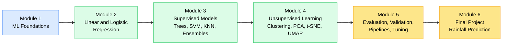
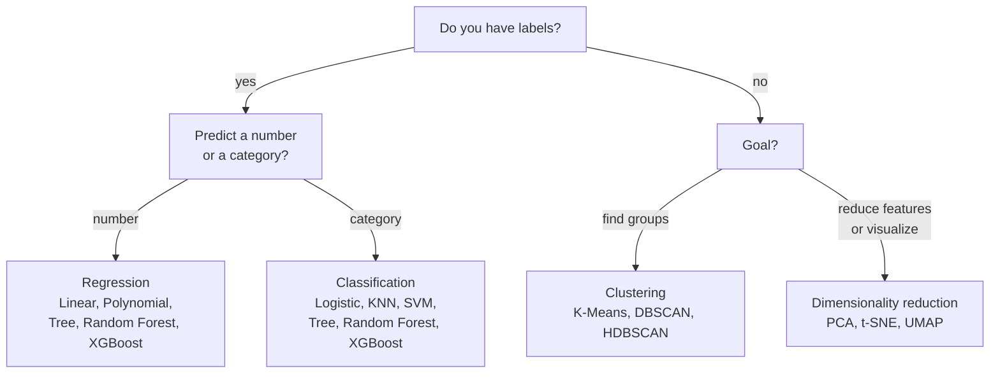
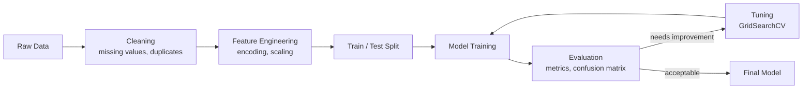
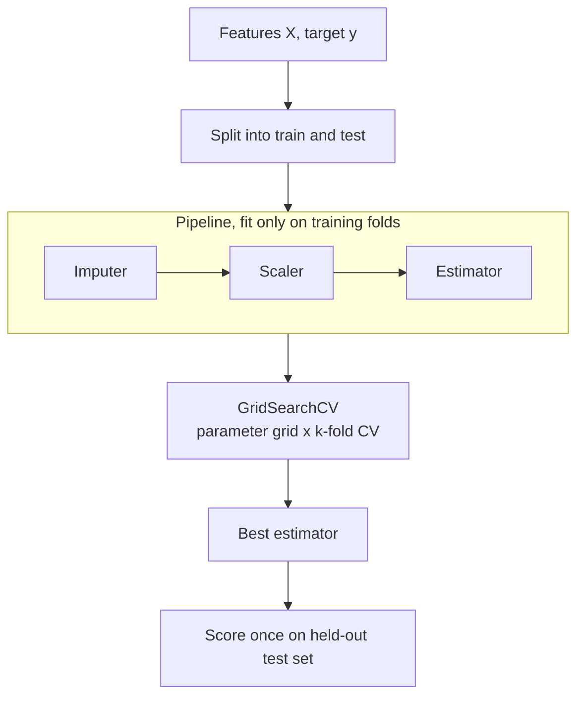
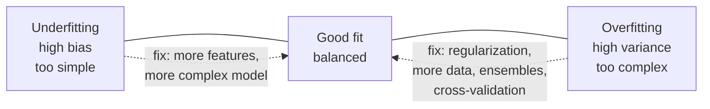
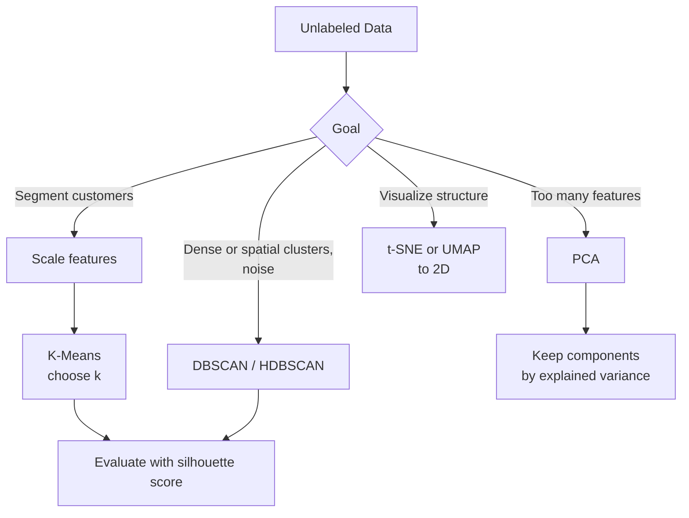
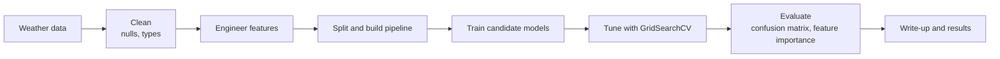

# Course 01: Machine Learning with Python


Step-by-step notebooks, line-by-line code explanations, theory notes and the final project for IBM's **Machine Learning with Python: Build Real-World ML Models**, Course 1 of the AI Engineer specialization.

- **Course link:** https://www.coursera.org/learn/machine-learning-with-python
- **Provider:** IBM
- **Instructor:** Joseph Santarcangelo
- **Format:** 6 modules, hands-on labs in Jupyter Notebooks, practice project (Titanic), final project (rainfall prediction)
- **Status:** ⬜ Not started

---

## Table of Contents

1. [What This Course Covers](#what-this-course-covers)
2. [Learning Outcomes](#learning-outcomes)
3. [Course Map](#course-map)
4. [Module Breakdown](#module-breakdown)
5. [Algorithm Cheat Sheet](#algorithm-cheat-sheet)
6. [Evaluation Metrics Cheat Sheet](#evaluation-metrics-cheat-sheet)
7. [Architecture Diagrams](#architecture-diagrams)
8. [Folder Structure](#folder-structure)
9. [Notebook Plan](#notebook-plan)
10. [Projects](#projects)
11. [Setup](#setup)
12. [Progress Tracker](#progress-tracker)
13. [Key Takeaways](#key-takeaways)

---

## What This Course Covers

An applied introduction to machine learning with Python and scikit-learn. You move from core ML concepts to regression, classification, ensembles, clustering and dimensionality reduction, then learn how to evaluate, validate and tune models with pipelines and cross-validation. The course ends with a practice project on the Titanic dataset and a final project that builds a rainfall prediction classifier from historical weather data.

---

## Learning Outcomes

By the end of this course you will be able to:

- Explain key machine learning concepts, tools and roles, including supervised and unsupervised learning
- Describe the machine learning model lifecycle and the work of a machine learning engineer
- Apply regression, classification, clustering and dimensionality reduction with Python and scikit-learn
- Evaluate model performance using appropriate metrics, validation strategies and optimization techniques
- Build complete ML pipelines and tune them with GridSearchCV while avoiding data leakage
- Build and assess end-to-end ML solutions on real-world datasets

---

## Course Map



---

## Module Breakdown

> Topic-to-module grouping is taken from the Coursera syllabus pages. Check the live course for the exact order inside each module.

### Module 1: Machine Learning Foundations

- [ ] Python and scikit-learn in machine learning
- [ ] Types of learning: supervised, unsupervised
- [ ] The machine learning model lifecycle
- [ ] Roles in AI and what a machine learning engineer does
- [ ] Open-source tools used in ML
- [ ] The IBM AI Engineering certification path
- [ ] Building and evaluating a simple model with scikit-learn

### Module 2: Linear and Logistic Regression

- [ ] Role of regression in predicting outcomes
- [ ] Simple vs multiple linear regression
- [ ] Polynomial and non-linear regression
- [ ] Logistic regression as a classification method
- [ ] Training and testing classification models
- [ ] Reference: Cheat Sheet, Linear and Logistic Regression

### Module 3: Building Supervised Learning Models

- [ ] How classification models predict categorical outcomes
- [ ] Multi-class classification strategies
- [ ] Decision trees for classification and regression
- [ ] Support Vector Machines (SVM), fraud detection use case
- [ ] K-Nearest Neighbors (KNN), customer classification use case
- [ ] Bias vs variance
- [ ] Ensemble methods: Random Forest and XGBoost
- [ ] Reference: Cheat Sheet, Building Supervised Learning Models

### Module 4: Building Unsupervised Learning Models

- [ ] Clustering concepts
- [ ] K-Means for customer segmentation
- [ ] DBSCAN and HDBSCAN for dense clusters in spatial data
- [ ] Dimensionality reduction for high-dimensional data
- [ ] PCA to uncover key components
- [ ] t-SNE and UMAP for visualizing data structure
- [ ] Reference: Cheat Sheet, Building Unsupervised Learning Models

### Module 5: Evaluating and Validating Models

- [ ] Classification and regression metrics
- [ ] Confusion matrices and feature importance charts
- [ ] Evaluating clustering quality
- [ ] Cross-validation to reduce overfitting
- [ ] Regularization to improve generalization and reduce feature complexity
- [ ] Machine learning pipelines
- [ ] Hyperparameter tuning with GridSearchCV
- [ ] Common pitfalls such as data leakage
- [ ] Practice project: Titanic dataset with pipelines, cross-validation and tuning
- [ ] Reference: Cheat Sheet, Evaluating and Validating Machine Learning Models

### Module 6: Final Project

- [ ] Rainfall prediction classifier on historical weather data
- [ ] Data cleaning
- [ ] Feature engineering
- [ ] Model building
- [ ] Performance evaluation

---

## Algorithm Cheat Sheet

| Algorithm | Type | Task | Key idea | scikit-learn class |
|---|---|---|---|---|
| Linear Regression | Supervised | Regression | Fits a straight line minimizing squared error | `LinearRegression` |
| Polynomial Regression | Supervised | Regression | Linear model on polynomial features | `PolynomialFeatures` + `LinearRegression` |
| Logistic Regression | Supervised | Classification | Sigmoid of a linear model gives class probability | `LogisticRegression` |
| Decision Tree | Supervised | Both | Splits data by feature thresholds | `DecisionTreeClassifier`, `DecisionTreeRegressor` |
| SVM | Supervised | Classification | Finds the maximum-margin boundary | `SVC` |
| KNN | Supervised | Classification | Votes among the k nearest neighbors | `KNeighborsClassifier` |
| Random Forest | Supervised, ensemble | Both | Many trees on random subsets, averaged | `RandomForestClassifier` |
| XGBoost | Supervised, ensemble | Both | Sequential trees that correct earlier errors | `xgboost.XGBClassifier` |
| K-Means | Unsupervised | Clustering | Assigns points to k centroids | `KMeans` |
| DBSCAN | Unsupervised | Clustering | Groups dense regions, flags noise | `DBSCAN` |
| HDBSCAN | Unsupervised | Clustering | Hierarchical density-based clustering | `HDBSCAN` |
| PCA | Unsupervised | Dimensionality reduction | Projects onto directions of maximum variance | `PCA` |
| t-SNE | Unsupervised | Visualization | Preserves local neighborhoods in 2D | `TSNE` |
| UMAP | Unsupervised | Visualization | Preserves local and some global structure | `umap.UMAP` |

### Choosing an algorithm



---

## Evaluation Metrics Cheat Sheet

| Task | Metric | Meaning | scikit-learn |
|---|---|---|---|
| Regression | MAE | Average absolute error | `mean_absolute_error` |
| Regression | MSE / RMSE | Average squared error, penalizes large misses | `mean_squared_error` |
| Regression | R² | Share of variance explained | `r2_score` |
| Classification | Accuracy | Share of correct predictions | `accuracy_score` |
| Classification | Precision | Of predicted positives, how many are right | `precision_score` |
| Classification | Recall | Of actual positives, how many were found | `recall_score` |
| Classification | F1 | Balance of precision and recall | `f1_score` |
| Classification | ROC AUC | Ranking quality across thresholds | `roc_auc_score` |
| Classification | Confusion matrix | Counts of TP, FP, TN, FN | `confusion_matrix` |
| Clustering | Silhouette score | How well points fit their own cluster | `silhouette_score` |

### Confusion matrix layout

|  | Predicted Positive | Predicted Negative |
|---|---|---|
| **Actual Positive** | True Positive (TP) | False Negative (FN) |
| **Actual Negative** | False Positive (FP) | True Negative (TN) |

---

## Architecture Diagrams

### End-to-end ML pipeline



### scikit-learn Pipeline with cross-validation and tuning



Putting every preprocessing step inside the pipeline keeps statistics learned from the training data away from the validation data, which prevents data leakage.

### Bias and variance



### Unsupervised learning flow



---

## Folder Structure

```
01-machine-learning-with-python/
├── README.md
├── notebooks/
├── notes/
└── project/
```

| Folder | What goes in it |
|---|---|
| `notebooks/` | Annotated notebooks with concept, code and line-by-line explanations, including your lab solutions |
| `notes/` | Theory notes, formulas and cheat sheets per module |
| `project/` | Titanic practice project and the rainfall prediction final project, with plots and write-up |

---

## Notebook Plan

| # | Notebook | Module | Covers |
|---|---|---|---|
| 01 | `01_ml_overview_and_lifecycle.ipynb` | 1 | ML types, lifecycle, first scikit-learn model |
| 02 | `02_simple_linear_regression.ipynb` | 2 | One feature, fit, predict, R² |
| 03 | `03_multiple_linear_regression.ipynb` | 2 | Several features, coefficients |
| 04 | `04_polynomial_regression.ipynb` | 2 | Non-linear patterns with polynomial features |
| 05 | `05_logistic_regression.ipynb` | 2 | Probabilities, decision boundary, train and test |
| 06 | `06_multiclass_classification.ipynb` | 3 | One-vs-rest and multinomial strategies |
| 07 | `07_decision_trees.ipynb` | 3 | Classification and regression trees |
| 08 | `08_svm_fraud_detection.ipynb` | 3 | SVM on a fraud dataset |
| 09 | `09_knn_customer_classification.ipynb` | 3 | KNN, choosing k |
| 10 | `10_bias_variance_and_ensembles.ipynb` | 3 | Random Forest, XGBoost |
| 11 | `11_kmeans_customer_segmentation.ipynb` | 4 | K-Means, elbow method |
| 12 | `12_dbscan_hdbscan.ipynb` | 4 | Density-based clustering |
| 13 | `13_pca.ipynb` | 4 | Principal components, explained variance |
| 14 | `14_tsne_umap.ipynb` | 4 | Visualizing high-dimensional data |
| 15 | `15_evaluation_metrics.ipynb` | 5 | Metrics, confusion matrix, feature importance |
| 16 | `16_cross_validation_regularization.ipynb` | 5 | k-fold CV, Ridge and Lasso |
| 17 | `17_pipelines_gridsearch_leakage.ipynb` | 5 | Pipelines, GridSearchCV, data leakage |
| 18 | `18_titanic_practice_project.ipynb` | 5 | Practice project |
| 19 | `19_rainfall_prediction_final.ipynb` | 6 | Final project |

Each notebook follows this order: title and objectives, concept, imports (explained), code cells each followed by a line-by-line table, output interpretation, common mistakes, key takeaways, practice exercise.

---

## Projects

### Practice project: Titanic survival classifier (Module 5)

- Build classification models with scikit-learn pipelines
- Evaluate with cross-validation
- Optimize with hyperparameter tuning

### Final project: Rainfall prediction classifier (Module 6)

- Dataset: historical weather data
- Steps: data cleaning, feature engineering, model building, performance evaluation
- Deliverables: notebook in `project/`, results summary, confusion matrix and feature importance plots saved inside `project/`



---

## Setup

```bash
cd 01-machine-learning-with-python
python -m venv .venv
source .venv/bin/activate            # Windows: .venv\Scripts\activate
pip install numpy pandas scipy scikit-learn matplotlib seaborn xgboost umap-learn jupyterlab
python -m ipykernel install --user --name ai-eng --display-name "Python (ai-eng)"
jupyter lab
```

Standard imports used throughout:

```python
import numpy as np
import pandas as pd
import matplotlib.pyplot as plt
import seaborn as sns
from sklearn.model_selection import train_test_split, cross_val_score, GridSearchCV
from sklearn.pipeline import Pipeline
from sklearn.preprocessing import StandardScaler
```

---

## Progress Tracker

| Module | Topic | Notebooks | Notes | Status |
|---|---|---|---|---|
| 1 | ML Foundations | 01 | ⬜ | ⬜ |
| 2 | Linear and Logistic Regression | 02 to 05 | ⬜ | ⬜ |
| 3 | Supervised Learning Models | 06 to 10 | ⬜ | ⬜ |
| 4 | Unsupervised Learning Models | 11 to 14 | ⬜ | ⬜ |
| 5 | Evaluation and Validation | 15 to 18 | ⬜ | ⬜ |
| 6 | Final Project | 19 | ⬜ | ⬜ |

Status key: ⬜ not started · 🟨 in progress · ✅ complete

---

## Key Takeaways

_Fill this in as you finish each module._

- Module 1:
- Module 2:
- Module 3:
- Module 4:
- Module 5:
- Module 6:

---

[Back to main repo](../README.md)
