<div align="center">

# 🧠 AI Engineer Specialization

### Step-by-step notebooks, line-by-line code explanations, theory notes and projects across 13 courses


</div>

---

## 📑 Table of Contents

1. [Overview](#-overview)
2. [Learning Path](#-learning-path)
3. [Repository Architecture](#-repository-architecture)
4. [Courses](#-courses)
5. [Concept Architecture Diagrams](#-concept-architecture-diagrams)
6. [Notebook Format](#-notebook-format)
7. [Tech Stack](#-tech-stack)
8. [Getting Started](#-getting-started)
9. [Workflow](#-workflow)
10. [Progress Tracker](#-progress-tracker)
11. [Skills Matrix](#-skills-matrix)
12. [Roadmap](#-roadmap)
13. [Contributing](#-contributing)
14. [License](#-license)
15. [Author](#-author)

---

## 🎯 Overview

This repository is a complete, hands-on record of the **AI Engineer specialization**: 13 courses, about **168 hours** of material, from classical machine learning to deep learning, transformers, LLM fine-tuning, RAG and AI agents.

Every topic is documented in the same detailed way:

- **Annotated Jupyter notebooks**: concept, code, and a line-by-line explanation of what each line does and why
- **Theory notes**: formulas, intuition and cheat sheets in plain markdown
- **Lab and project solutions**: graded work with write-ups
- **Reusable code**: clean `.py` modules extracted from the notebooks
- **Diagrams**: architecture and pipeline visuals for every major concept

### Goals

| Goal | How this repo delivers it |
|---|---|
| Deep understanding | Every line of code is explained, not just run |
| Reproducibility | Pinned dependencies, fixed seeds, relative paths |
| Portfolio quality | Clean structure, READMEs per course, real projects |
| Fast revision | Notes, cheat sheets and takeaways per notebook |

---

## 🗺 Learning Path

```mermaid
flowchart LR
    A["Foundations<br/>Python, NumPy, Pandas"] --> B["Course 01<br/>Machine Learning"]
    B --> C["Course 02<br/>Deep Learning with Keras"]
    C --> D["Course 03<br/>Keras and TensorFlow"]
    B --> E["Course 04<br/>Neural Networks and PyTorch"]
    E --> F["Course 05<br/>Deep Learning with PyTorch"]
    D --> G["Course 06<br/>AI Capstone"]
    F --> G
    G --> H["Course 07<br/>LLM Architecture and Data"]
    H --> I["Course 08<br/>Foundational NLP Models"]
    I --> J["Course 09<br/>Transformers"]
    J --> K["Course 10<br/>Fine-Tuning Transformers"]
    K --> L["Course 11<br/>Advanced LLM Fine-Tuning"]
    L --> M["Course 12<br/>AI Agents, RAG, LangChain"]
    M --> N["Course 13<br/>RAG Capstone Project"]

    classDef ml fill:#dbeafe,stroke:#3b82f6,color:#000;
    classDef dl fill:#fde68a,stroke:#f59e0b,color:#000;
    classDef genai fill:#dcfce7,stroke:#22c55e,color:#000;
    class B ml;
    class C,D,E,F,G dl;
    class H,I,J,K,L,M,N genai;
```

**Legend:** 🔵 Classical ML · 🟡 Deep Learning · 🟢 Generative AI and LLMs

---

## 🏗 Repository Architecture

### Folder structure

```
ai-engineer-specialization/
│
├── README.md                          # This file
├── LICENSE
├── requirements.txt                   # All Python dependencies
├── .gitignore
│
├── docs/                              # Repo-wide documentation
│   ├── NOTEBOOK_TEMPLATE.md           # Standard notebook format
│   ├── GIT_WORKFLOW.md                # Commit and branch conventions
│   └── GLOSSARY.md                    # Terms and definitions
│
├── shared/                            # Code and data shared by all courses
│   ├── utils/                         # Plotting, metrics, data loaders
│   └── datasets/                      # Small datasets, download scripts
│
├── 01-machine-learning-with-python/
├── 02-intro-deep-learning-keras/
├── 03-deep-learning-keras-tensorflow/
├── 04-intro-neural-networks-pytorch/
├── 05-deep-learning-pytorch/
├── 06-ai-capstone-deep-learning/
├── 07-genai-llm-architecture-data-prep/
├── 08-genai-foundational-models-nlp/
├── 09-genai-language-modeling-transformers/
├── 10-genai-engineering-finetuning-transformers/
├── 11-genai-advanced-finetuning-llms/
├── 12-ai-agents-rag-langchain/
└── 13-project-genai-rag-langchain/
```

### Inside every course folder

```
NN-course-name/
├── README.md        # Course overview, module checklist, key concepts
├── notebooks/       # Annotated Jupyter notebooks (one per topic, labs included)
├── notes/           # Theory notes in markdown
└── project/         # Graded assignments and final project
```

### How the pieces connect

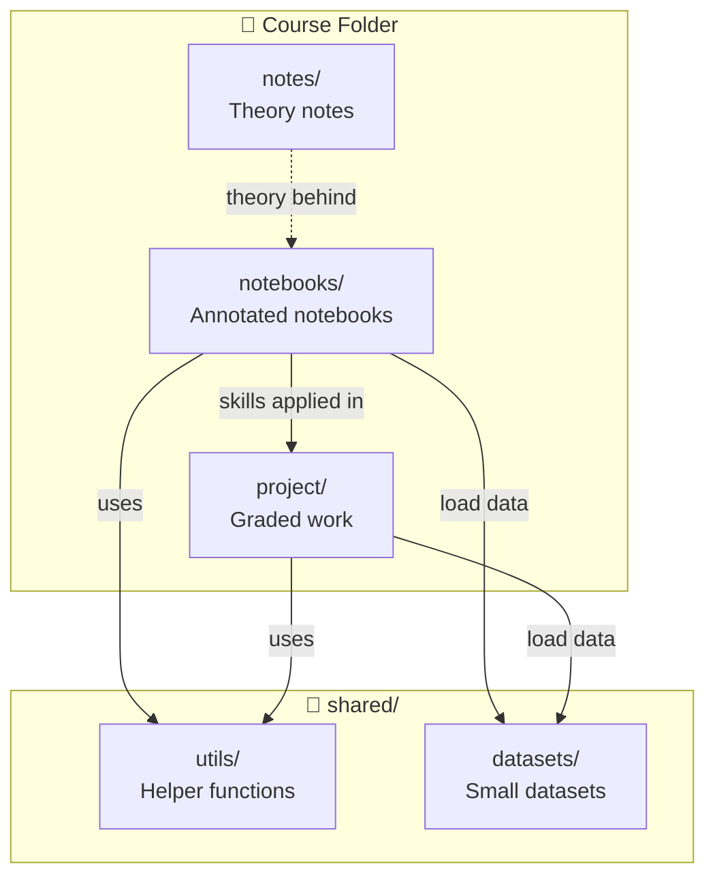

---

## 📚 Courses

| # | Course | Hours | Focus | Folder |
|---|---|---|---|---|
| 01 | Machine Learning with Python: Build Real-World ML Models | 20 | Regression, classification, clustering, evaluation | [📂](01-machine-learning-with-python/) |
| 02 | Introduction to Deep Learning & Neural Networks with Keras | 10 | Perceptrons, backpropagation, first Keras models | [📂](02-intro-deep-learning-keras/) |
| 03 | Deep Learning with Keras and TensorFlow | 23 | CNNs, RNNs, autoencoders, transfer learning | [📂](03-deep-learning-keras-tensorflow/) |
| 04 | Introduction to Neural Networks and PyTorch | 19 | Tensors, autograd, training loops | [📂](04-intro-neural-networks-pytorch/) |
| 05 | Deep Learning with PyTorch | 21 | Deep networks, CNNs, regularization | [📂](05-deep-learning-pytorch/) |
| 06 | AI Capstone Project with Deep Learning | 15 | End-to-end deep learning project | [📂](06-ai-capstone-deep-learning/) |
| 07 | Generative AI and LLMs: Architecture and Data Preparation | 6 | Tokenization, embeddings, text data pipelines | [📂](07-genai-llm-architecture-data-prep/) |
| 08 | Gen AI Foundational Models for NLP & Language Understanding | 10 | Language models, NLP tasks | [📂](08-genai-foundational-models-nlp/) |
| 09 | Generative AI Language Modeling with Transformers | 9 | Attention, transformer blocks, GPT and BERT | [📂](09-genai-language-modeling-transformers/) |
| 10 | Generative AI Engineering and Fine-Tuning Transformers | 8 | Hugging Face, PEFT, LoRA | [📂](10-genai-engineering-finetuning-transformers/) |
| 11 | Generative AI Advanced Fine-Tuning for LLMs | 9 | Instruction tuning, RLHF, DPO | [📂](11-genai-advanced-finetuning-llms/) |
| 12 | Fundamentals of AI Agents Using RAG and LangChain | 9 | Embeddings, vector stores, RAG, agents | [📂](12-ai-agents-rag-langchain/) |
| 13 | Project: Generative AI Applications with RAG and LangChain | 9 | Full RAG application | [📂](13-project-genai-rag-langchain/) |

**Total: 168 hours**

### Course Breakdown by Category

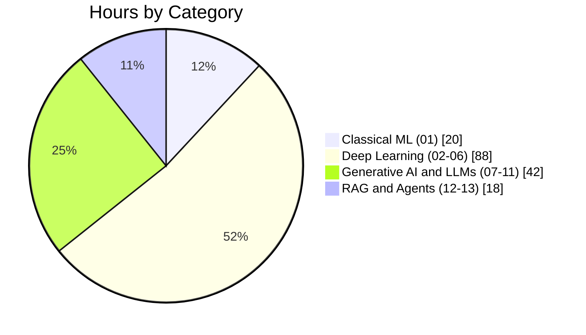

---

## 🧩 Concept Architecture Diagrams

### 1. Machine Learning Pipeline (Course 01)

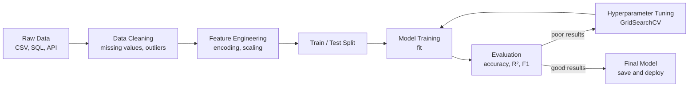

### 2. Neural Network Training Loop (Courses 02 to 05)

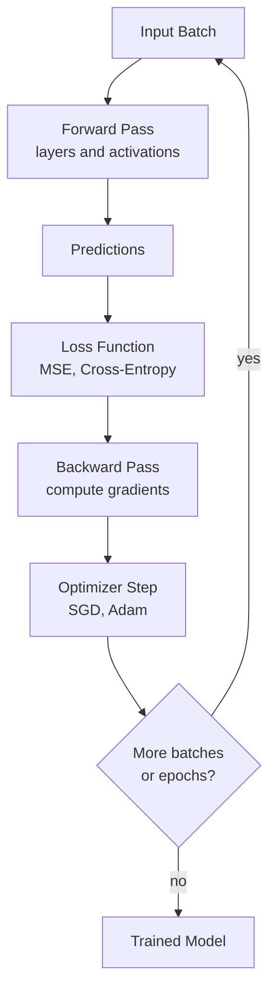

### 3. Feed-Forward Network Structure

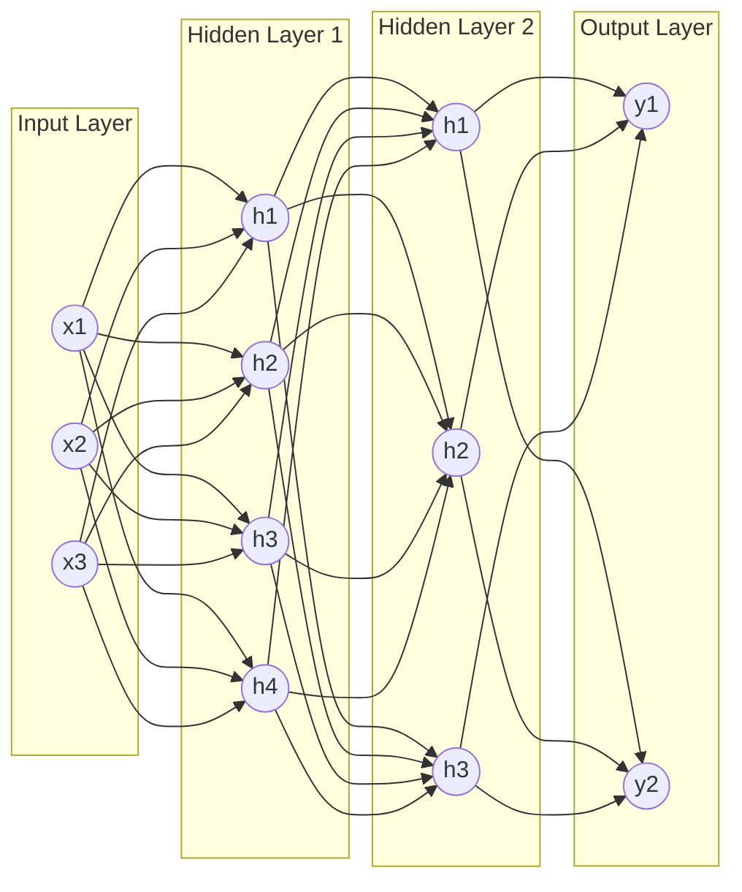

### 4. Convolutional Neural Network (Courses 03 and 05)

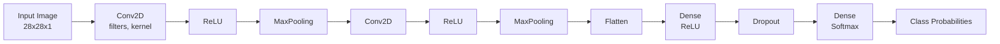

### 5. Transfer Learning (Courses 03 and 05)

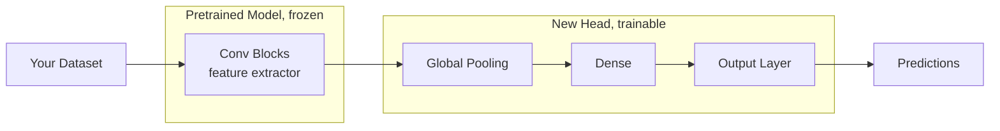

### 6. Transformer Architecture (Course 09)

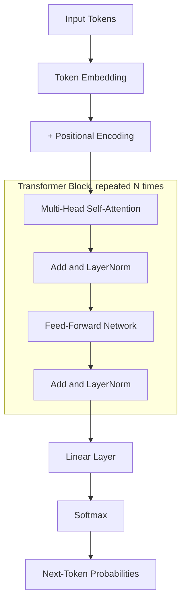

### 7. Self-Attention Mechanism (Course 09)

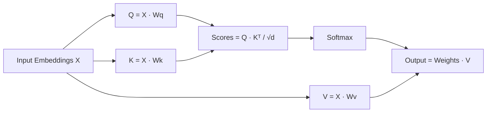

### 8. LLM Data Preparation Pipeline (Course 07)

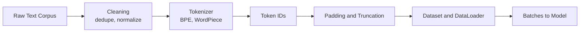

### 9. Fine-Tuning with LoRA (Courses 10 and 11)

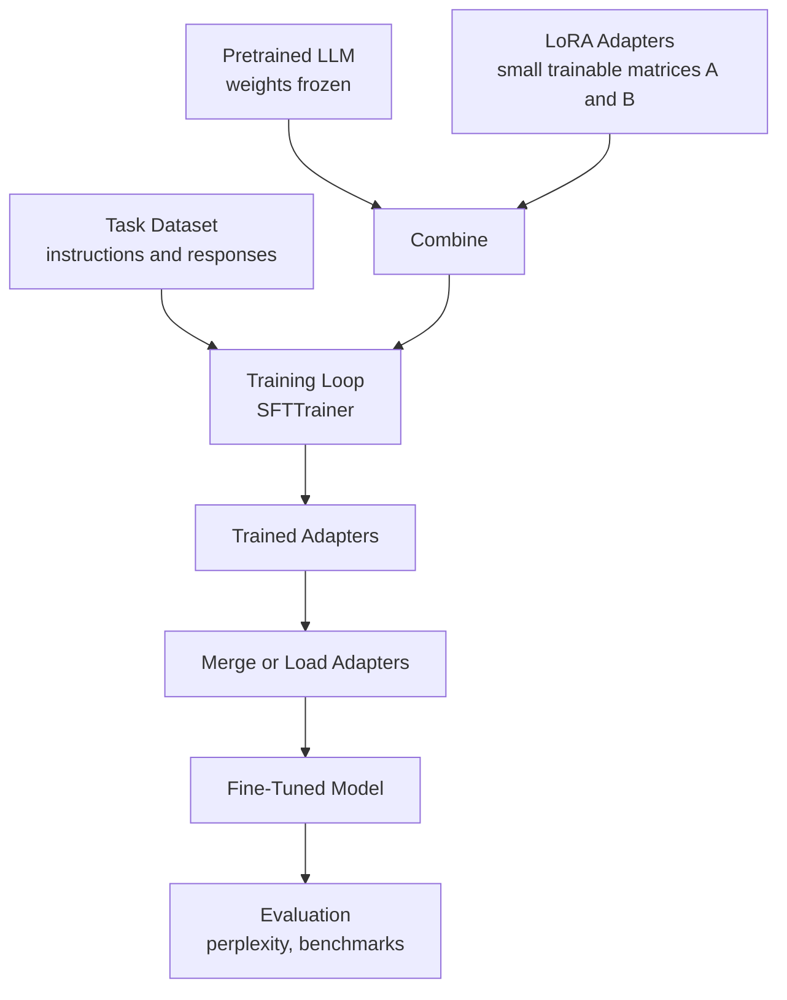

### 10. RLHF and DPO Alignment (Course 11)

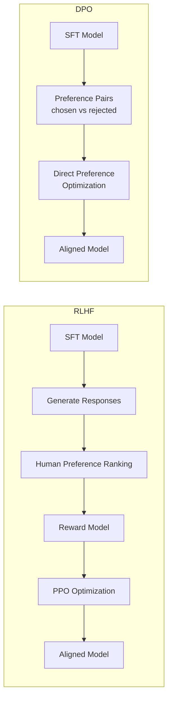

### 11. RAG Pipeline (Courses 12 and 13)

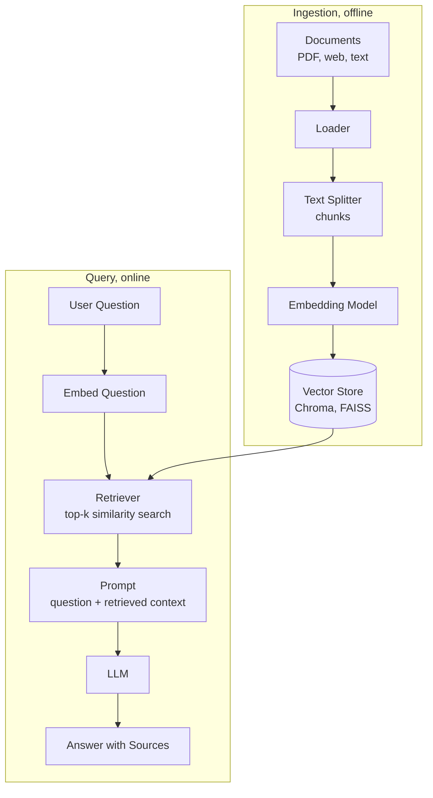

### 12. RAG Request Sequence

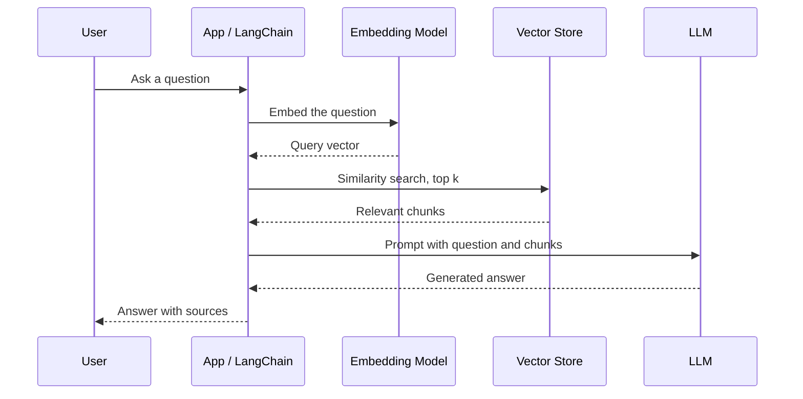

### 13. AI Agent Loop (Course 12)

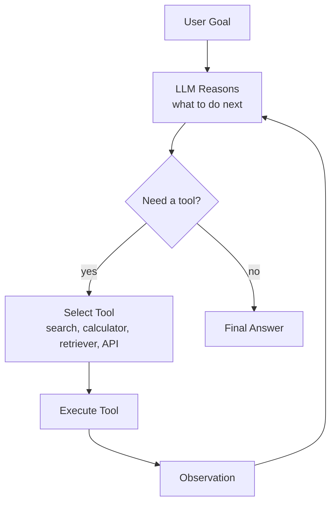

### 14. Capstone Project System (Course 13)

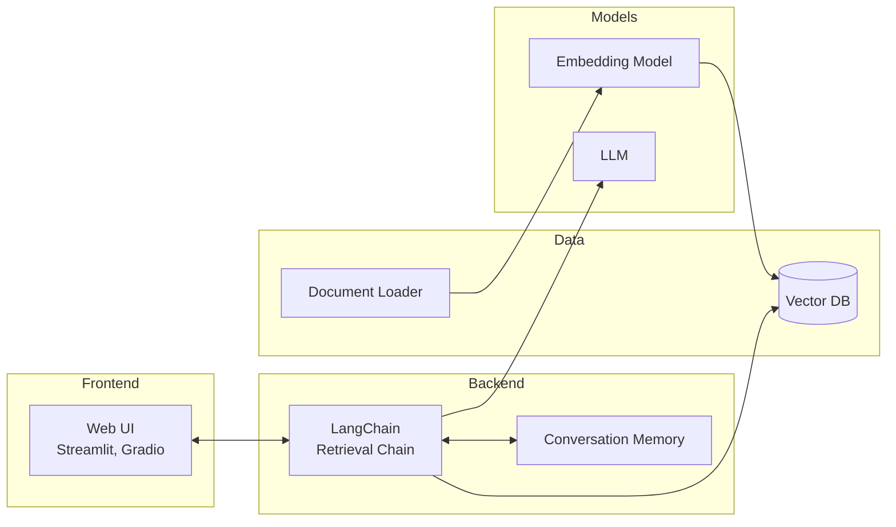

---

## 📓 Notebook Format

Every notebook follows one consistent structure:

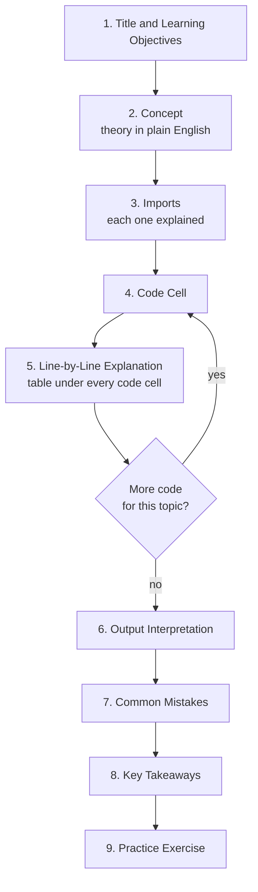

### Line-by-line example

```python
X_train, X_test, y_train, y_test = train_test_split(X, y, test_size=0.2, random_state=42)
```

| Part | What it does | Why |
|---|---|---|
| `train_test_split(X, y, ...)` | Randomly splits features and labels into two sets | Test on data the model has never seen |
| `test_size=0.2` | 20% goes to the test set, 80% to training | Standard split ratio |
| `random_state=42` | Fixes the shuffle seed | Same split every run |
| `X_train, X_test, y_train, y_test` | Four outputs unpacked in order | Training and test features and labels |

---

## 🛠 Tech Stack

| Area | Tools |
|---|---|
| Language | Python 3.10+ |
| Data | NumPy, Pandas, SciPy |
| Visualization | Matplotlib, Seaborn |
| Classical ML | scikit-learn |
| Deep learning | TensorFlow, Keras, PyTorch, torchvision |
| NLP and LLMs | Hugging Face Transformers, Datasets, Tokenizers |
| Fine-tuning | PEFT, TRL, Accelerate |
| RAG and agents | LangChain, ChromaDB, FAISS |
| Apps | Streamlit |
| Environment | JupyterLab, venv, Git, GitHub |

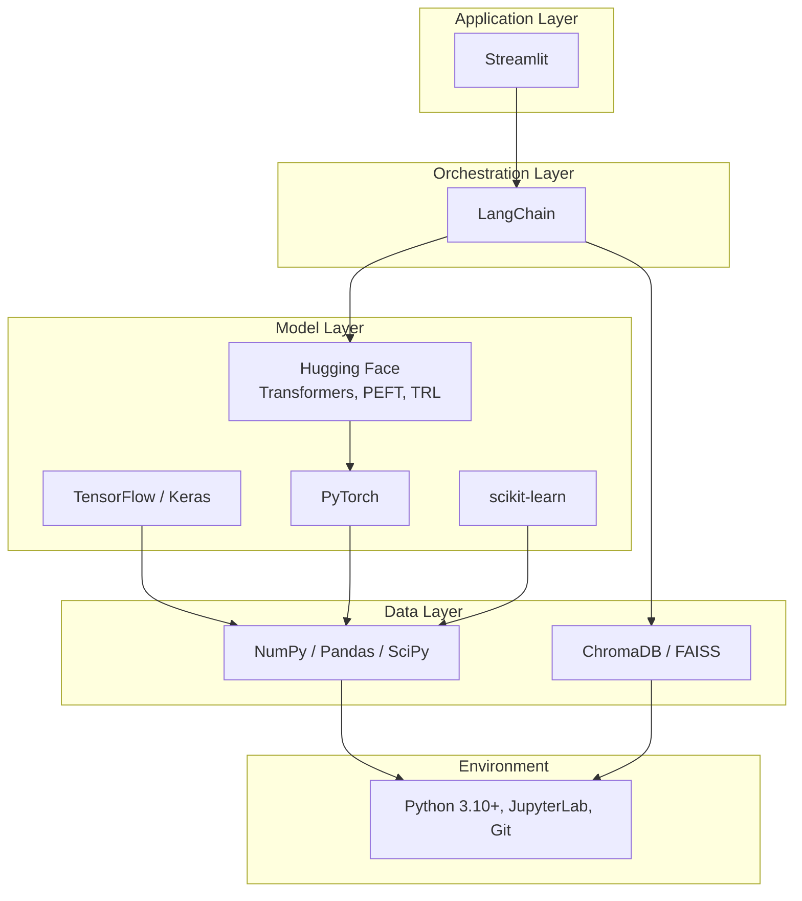

---

## 🚀 Getting Started

### Prerequisites

- Python 3.10 or newer
- Git
- About 10 GB of free disk space (more if you train large models)
- Optional: NVIDIA GPU with CUDA for the PyTorch, TensorFlow and fine-tuning courses

### Installation

```bash
# 1. Clone the repository
git clone https://github.com/abhirajbalyan/ai-engineer-specialization.git
cd ai-engineer-specialization

# 2. Create and activate a virtual environment
python -m venv .venv
source .venv/bin/activate          # Windows: .venv\Scripts\activate

# 3. Install dependencies
pip install --upgrade pip
pip install -r requirements.txt

# 4. Register the Jupyter kernel
python -m ipykernel install --user --name ai-eng --display-name "Python (ai-eng)"

# 5. Launch JupyterLab
jupyter lab
```

### Install per course (lighter setup)

| Courses | Install |
|---|---|
| 01 | `pip install numpy pandas scipy scikit-learn matplotlib seaborn jupyterlab` |
| 02, 03 | `pip install tensorflow keras` |
| 04, 05 | `pip install torch torchvision torchaudio` |
| 07 to 11 | `pip install transformers datasets tokenizers peft trl accelerate` |
| 12, 13 | `pip install langchain langchain-community chromadb faiss-cpu python-dotenv streamlit` |

### Environment variables

Courses that call hosted model APIs need keys. Create a `.env` file in the repo root (it is git-ignored):

```
OPENAI_API_KEY=your_key_here
HUGGINGFACEHUB_API_TOKEN=your_token_here
```

Load them in a notebook:

```python
from dotenv import load_dotenv
load_dotenv()
```

### How to navigate

1. Open a course folder, for example `01-machine-learning-with-python/`.
2. Read its `README.md` for the module list.
3. Open `notebooks/` and go in numeric order.
4. Read `notes/` for the theory behind each notebook.
5. Check the graded work in `project/`.

---

## 🔄 Workflow

### Building the repo, per course

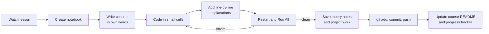

### Git workflow

```mermaid
gitGraph
    commit id: "Initial structure"
    branch course-01
    checkout course-01
    commit id: "Add regression notebook"
    commit id: "Add classification notebook"
    commit id: "Add course 01 notes"
    checkout main
    merge course-01 id: "Complete course 01"
    branch course-02
    checkout course-02
    commit id: "Add perceptron notebook"
    commit id: "Add Keras models"
    checkout main
    merge course-02 id: "Complete course 02"
```

### Commit message convention

```
Add <what> (course NN)
Update <what> (course NN)
Fix <what> in <file>
Docs: update README progress
```

---

## ✅ Progress Tracker

Status key: ⬜ not started · 🟨 in progress · ✅ complete

| # | Course | Notebooks | Notes | Labs | Project | Status |
|---|---|---|---|---|---|---|
| 01 | Machine Learning with Python | 0 | 0 | 0 | 0 | ⬜ |
| 02 | Intro to Deep Learning with Keras | 0 | 0 | 0 | 0 | ⬜ |
| 03 | Deep Learning with Keras and TensorFlow | 0 | 0 | 0 | 0 | ⬜ |
| 04 | Intro to Neural Networks and PyTorch | 0 | 0 | 0 | 0 | ⬜ |
| 05 | Deep Learning with PyTorch | 0 | 0 | 0 | 0 | ⬜ |
| 06 | AI Capstone Project | 0 | 0 | 0 | 0 | ⬜ |
| 07 | GenAI and LLMs: Architecture and Data Prep | 0 | 0 | 0 | 0 | ⬜ |
| 08 | Gen AI Foundational Models for NLP | 0 | 0 | 0 | 0 | ⬜ |
| 09 | GenAI Language Modeling with Transformers | 0 | 0 | 0 | 0 | ⬜ |
| 10 | GenAI Engineering and Fine-Tuning | 0 | 0 | 0 | 0 | ⬜ |
| 11 | GenAI Advanced Fine-Tuning for LLMs | 0 | 0 | 0 | 0 | ⬜ |
| 12 | AI Agents Using RAG and LangChain | 0 | 0 | 0 | 0 | ⬜ |
| 13 | Project: GenAI Apps with RAG and LangChain | 0 | 0 | 0 | 0 | ⬜ |

```mermaid
gantt
    title Completion Plan
    dateFormat  YYYY-MM-DD
    axisFormat  %b %d
    section Classical ML
    Course 01           :c1, 2026-11-15, 10d
    section Deep Learning
    Course 02           :c2, after c1, 5d
    Course 03           :c3, after c2, 11d
    Course 04           :c4, after c3, 10d
    Course 05           :c5, after c4, 10d
    Course 06           :c6, after c5, 8d
    section Generative AI
    Course 07           :c7, after c6, 3d
    Course 08           :c8, after c7, 5d
    Course 09           :c9, after c8, 5d
    Course 10           :c10, after c9, 4d
    Course 11           :c11, after c10, 5d
    section RAG and Agents
    Course 12           :c12, after c11, 5d
    Course 13           :c13, after c12, 5d
```

> Adjust the start dates in the Gantt block to match your actual schedule.

---

## 🎓 Skills Matrix

| Skill | Courses | Level |
|---|---|---|
| Data wrangling (Pandas, NumPy) | 01 | ⭐⭐⭐⭐ |
| Supervised and unsupervised ML | 01 | ⭐⭐⭐⭐ |
| Model evaluation and tuning | 01 | ⭐⭐⭐⭐ |
| Neural networks from scratch | 02, 04 | ⭐⭐⭐⭐ |
| Keras and TensorFlow | 02, 03 | ⭐⭐⭐⭐ |
| PyTorch | 04, 05 | ⭐⭐⭐⭐ |
| CNNs and computer vision | 03, 05, 06 | ⭐⭐⭐⭐ |
| Sequence models | 03, 08 | ⭐⭐⭐ |
| Tokenization and embeddings | 07 | ⭐⭐⭐⭐ |
| Transformers and attention | 09 | ⭐⭐⭐⭐ |
| Hugging Face ecosystem | 10, 11 | ⭐⭐⭐⭐ |
| PEFT, LoRA, fine-tuning | 10, 11 | ⭐⭐⭐⭐ |
| RLHF and DPO | 11 | ⭐⭐⭐ |
| RAG systems | 12, 13 | ⭐⭐⭐⭐ |
| AI agents and tool use | 12 | ⭐⭐⭐ |
| LangChain apps | 12, 13 | ⭐⭐⭐⭐ |

> Update the star levels as you complete each course.

---

## 🧭 Roadmap

- [ ] Set up repo structure and templates
- [ ] Complete courses 01 to 03 (ML and Keras)
- [ ] Complete courses 04 to 06 (PyTorch and capstone)
- [ ] Complete courses 07 to 09 (LLM foundations and transformers)
- [ ] Complete courses 10 and 11 (fine-tuning)
- [ ] Complete courses 12 and 13 (RAG and agents)
- [ ] Add a unified glossary in `docs/GLOSSARY.md`
- [ ] Add CI to check that every notebook runs
- [ ] Publish a rendered documentation site with GitHub Pages
- [ ] Tag release `v1.0`

---

## 🤝 Contributing

Suggestions and corrections are welcome.

1. Fork the repository
2. Create a branch: `git checkout -b fix/typo-in-course-03`
3. Commit your changes: `git commit -m "Fix typo in course 03 notes"`
4. Push: `git push origin fix/typo-in-course-03`
5. Open a Pull Request

Please keep notebooks in the standard format described in `docs/NOTEBOOK_TEMPLATE.md`.

---

## 📄 License

Released under the [MIT License](LICENSE).

Course content and materials belong to their respective creators and instructors. This repository contains only original notes, explanations and personal solutions, for educational purposes.

---

## 👤 Author

**Abhiraj**

- GitHub: [@abhirajbalyan](https://github.com/abhirajbalyan)

---

<div align="center">

⭐ If this repo helps you, consider giving it a star.

</div>
